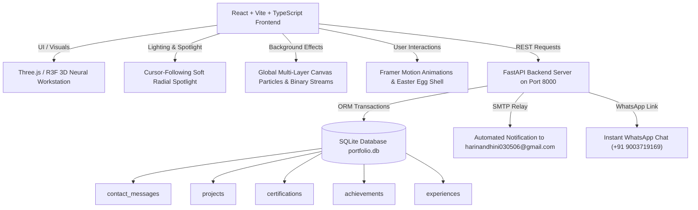

# Hari Nandhini S — Professional Portfolio Website

An interactive, futuristic personal digital portfolio and engineering showcase designed for **Hari Nandhini S**, Software Systems student at Coimbatore Institute of Technology (CIT), specializing in full-stack software development, machine learning, and data analytics.

---

## 🚀 Live Architectural Overview



---

## 🧭 Strategic Section Progression

The website is architected into a cohesive narrative sequence, transitioning from immediate credentials and engineering evidence to personal reflection:

1. **Hero Section (`#home`)**: 3D holographic neural net, CIT academic status pill, micro-metrics counter, and direct CTAs. Generously padded to prevent navbar overlap.
2. **Experience Timeline (`#experience`)**: Part-time Web Developer role at Studio 3 Interactive and Secretary & Joint Secretary leadership roles at 403 STRATS with official vector logos and illuminated beacons.
3. **Skills Engine (`#skills`)**: Continuous dual-direction infinite technology logo marquee (with pause-on-hover) powered by official SVGs, plus an interactive category explorer with proficiency context.
4. **Academic Foundation (`#education`)**: CIT M.Sc. Software Systems (CGPA: 8.85 / 10.0) and G.K.D. Matric HSS (HSC: 92.83%, SSLC: 97%) with institutional crests.
5. **Featured Engineering Projects (`#projects`)**: 8 genuine built applications (VoxNira, AgriMind, Land-IQ, Nexara AI, Enterprise AI Voice Agent, Fraud Detection, Detective Game, Smart Banking) with custom SVG covers and deep-dive interactive simulators. Strictly displays verified links (**View GitHub** and **View Details**).
6. **Verified Certifications (`#certifications`)**: Infosys Springboard Generative AI, Guvi Python, and HackerRank with light-sweep preview frames and modal inspector.
7. **Achievements & Recognition (`#achievements`)**: Academic Centum award, Pitch Pit & HackMars finalist rankings, and technical workshop leadership with illuminated trophy cards.
8. **Resume Hub (`#resume`)**: Dual track cards configured via `resumeConfig.ts`. Displays an honest "Coming Soon / Request via Email" state until official PDFs are placed.
9. **Communication Terminal (`#contact`)**: 3-way contact delivery—direct email dispatch via FastAPI SMTP, instant prefilled WhatsApp chat to `+919003719169`, and persistent SQLite recording.
10. **Behind the Code (`#about`)**: Multi-dimensional digital identity finale presenting 5 facets: *The Developer, The Data Explorer, The Problem Solver, The Team Player, and The Learner*.
11. **Footer**: Navigation map, institutional base information, and tech stack signature.

---

## 🎨 Visual Identity & Theme System

* **Dark Theme Palette:**
  * Background: `#050B16`
  * Secondary Background: `#0A1424`
  * Electric Blue: `#168BFF`
  * Neon Cyan: `#38D9FF`
  * Bright Orange: `#FF852E`
  * High-contrast text: `#F4F7FC`
  * Muted text: `#9BAAC0`

* **Light Theme Palette:**
  * Background: `#F5F8FC`
  * Secondary Background: `#EAF0F8`
  * Card Background: `#FFFFFF`
  * Primary Text: `#10213A`
  * Secondary Text: `#52647B`
  * Electric Blue: `#087BEA`
  * Bright Orange: `#EF7928`
  * Border Color: `#DCE5F0`

* **Soft Radial Spotlight:** Dynamic cursor-following radial spotlight with blue/cyan illumination that reacts smoothly to pointer movement.
* **Dual Theme Engine:** Dark and light mode toggle with smooth CSS transitions, persisted in `localStorage`.
* **Interactive 3D Workstation:** Rotating neural network built with Three.js and React Three Fiber.

---

## 🛠️ Technology Stack

| Layer | Technologies |
| :--- | :--- |
| **Frontend Framework** | React 18, Vite 5, TypeScript 5.5 |
| **Styling & Design** | Tailwind CSS 3, PostCSS, Autoprefixer, Custom Glassmorphism |
| **3D & Graphics** | Three.js, `@react-three/fiber`, `@react-three/drei` |
| **Motion & Physics** | Framer Motion 11, Canvas Confetti |
| **Icons & Typography** | Lucide React, Custom TechIcon SVGs, Space Grotesk, Inter, JetBrains Mono |
| **Backend Framework** | Python 3, FastAPI, Uvicorn (ASGI) |
| **Database & ORM** | SQLite, SQLAlchemy 2.0 ORM, Pydantic V2 |
| **Data Resiliency** | Automatic static fallback layer in `api.ts` if backend is unreachable |

---

## ⚡ Quick Start & Execution Guide

### 1. Run the Entire Stack (One-Click)
On Windows, double-click **`run_dev.bat`** or run in PowerShell:
```powershell
.\run_dev.ps1
```
This automatically launches:
* **FastAPI Backend:** `http://127.0.0.1:8000`
* **Vite React Frontend:** `http://localhost:5173`

---

### 2. Manual Start Instructions

#### A. Backend (Python + FastAPI)
From the root directory:
```bash
python backend/run.py
```
* Backend API: `http://127.0.0.1:8000`
* Interactive Swagger API Docs: `http://127.0.0.1:8000/docs`
* Database file: `backend/portfolio.db`

#### B. Frontend (React + Vite + TypeScript)
In a new terminal:
```bash
cd frontend
npm run dev
```
* Frontend Web App: `http://localhost:5173`

---

## 📄 Managing Your Official Resumes

Official PDF resumes are configured through a dedicated configuration module:
[`frontend/src/config/resumeConfig.ts`](file:///c:/Users/HARI%20NANDHINI/OneDrive/Desktop/Hari%20Nandhini%20S%20-%20Portfolio/frontend/src/config/resumeConfig.ts)

### How to Upload Your Official Resumes:
1. Export your official PDF files.
2. Place them into:
   ```
   frontend/public/resumes/Hari_Nandhini_S_SDE.pdf
   frontend/public/resumes/Hari_Nandhini_S_Data_AI.pdf
   ```
3. Open `frontend/src/config/resumeConfig.ts` and set `isAvailable: true`:
   ```typescript
   softwareDevelopment: {
     filename: "Hari_Nandhini_S_SDE.pdf",
     path: "/resumes/Hari_Nandhini_S_SDE.pdf",
     isAvailable: true,
   },
   dataAI: {
     filename: "Hari_Nandhini_S_Data_AI.pdf",
     path: "/resumes/Hari_Nandhini_S_Data_AI.pdf",
     isAvailable: true,
   }
   ```
The website will immediately replace the "Coming Soon" badge with direct one-click PDF downloads.

---

## 📸 Managing Certificate & Achievement Images

Visual previews are managed in [`frontend/src/config/portfolioImages.ts`](file:///c:/Users/HARI%20NANDHINI/OneDrive/Desktop/Hari%20Nandhini%20S%20-%20Portfolio/frontend/src/config/portfolioImages.ts):
1. Place scanned credentials or ceremony photos into:
   * Certificates: `frontend/public/images/certificates/`
   * Achievements: `frontend/public/images/achievements/`
2. Update the filename and toggle `isUploaded: true` in `portfolioImages.ts`.

---

## 📡 REST API Reference

| Method | Endpoint | Description |
| :--- | :--- | :--- |
| `GET` | `/` | API status and service discovery |
| `GET` | `/api/health` | Health-check endpoint |
| `GET` | `/api/projects` | List all projects (supports `?category=` filter) |
| `GET` | `/api/projects/{slug}` | Get full details for a single project |
| `GET` | `/api/certifications` | List verified accredited certifications |
| `GET` | `/api/achievements` | List awards, hackathons, and workshops |
| `GET` | `/api/experience` | List leadership and work history |
| `POST` | `/api/contact` | 3-way delivery: SMTP email, WhatsApp formatting & SQLite storage |

---

## 🧪 Testing and Verification

Run the automated backend test suite:
```bash
python test_backend.py
```
Output:
```text
Testing direct route functions & database models...
 Projects: Retrieved 8 items.
   First project: VoxNira — Multilingual Medical AI Triage Assistant [Artificial Intelligence]
   Slug lookup voxnira: VoxNira — Multilingual Medical AI Triage Assistant
 Certifications: Retrieved 3 items.
 Achievements: Retrieved 4 items.
 Experience: Retrieved 3 items.
 Contact Submission Result: Thank you, CIT Tech Lead! Your message has been saved in Hari's database and will be reviewed shortly.
 Database Persistence Confirmed: Message ID 1 saved in SQLite!

 ALL BACKEND SYSTEM AND DATABASE TESTS PASSED WITH 100% SUCCESS!
```

Run frontend production build verification:
```bash
cd frontend
npm run build
```
Builds cleanly with zero errors in ~18 seconds.

---

## 👤 Author Contact

* **Name:** Hari Nandhini S
* **Institution:** Coimbatore Institute of Technology (CIT) — M.Sc. Software Systems (5-Year Integrated)
* **Email:** [harinandhini030506@gmail.com](mailto:harinandhini030506@gmail.com)
* **Phone:** +91 9003719169
* **Location:** Coimbatore, Tamil Nadu, India
* **GitHub:** [https://github.com/HARI-NANDHINI-S](https://github.com/HARI-NANDHINI-S)
* **LinkedIn:** [https://www.linkedin.com/in/hari-nandhini-s-76932a321/](https://www.linkedin.com/in/hari-nandhini-s-76932a321/)
